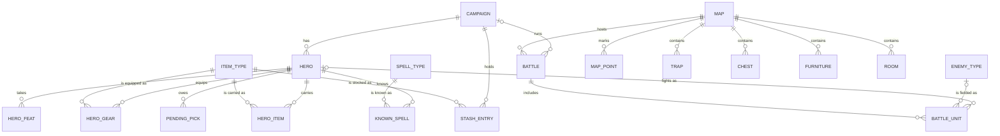

# Entity Model

The game keeps one campaign per browser. The campaign and its heroes are saved; battle entities exist only while a battle runs and are rebuilt from the saved campaign. Requirements are in [requirements](requirements.md) and terms in [glossary](glossary.md). The game ships its catalogs (item types, spell types, enemy types) as fixed data; the model lists them so that every reference has a target.

## Entity Relationship Diagram

## Saved Campaign Entities

### CAMPAIGN

The one persistent game in this browser, holding the gold, the day count, the experience, and the state of the current delve. The campaign journal, a list of log lines, is not modeled.

| Attribute | Description | Data Type | Length/Precision | Validation Rules |
|-----------|-------------|-----------|------------------|------------------|
| id | Unique identifier | Long | 19 | Primary Key, Sequence |
| gold | Gold held by the campaign | Integer | 10 | Not Null |
| day | Day count, advanced by each rest in town and each battle | Integer | 10 | Not Null |
| experience | Experience points earned by the party | Integer | 10 | Not Null |
| checkpoints_reached | Number of checkpoints the campaign has passed | Integer | 10 | Not Null, Min: 0, Max: 4 |
| delve_floor | Floor the current delve is on; 0 when no delve is running | Integer | 10 | Not Null, Min: 0, Max: 3 |
| in_delve | Whether a delve is running, which locks town services | Boolean | 1 | Not Null |

#### Constraints

- Gold is never below 0.
- Day starts at 1 and never decreases.
- While in_delve is true, delve_floor is between 1 and 3.

### HERO

One of the eight campaign heroes, active in the party or waiting in the reserve. Its hit points and spell debt carry from one floor to the next.

| Attribute | Description | Data Type | Length/Precision | Validation Rules |
|-----------|-------------|-----------|------------------|------------------|
| id | Unique identifier | Long | 19 | Primary Key, Sequence |
| campaign_id | Campaign the hero belongs to | Long | 19 | Not Null, Foreign Key (CAMPAIGN.id) |
| name | Name of the hero | String | 50 | Not Null, Unique |
| race | Race that sets the stat bonus | String | 10 | Not Null, Values: human, dwarf, elf, halfling |
| class | Class that sets skill, armor and spells | String | 10 | Not Null, Values: fighter, rogue, mage, cleric, ranger |
| is_active | Whether the hero is in the party rather than the reserve | Boolean | 1 | Not Null |
| strength | Current Strength | Integer | 10 | Not Null |
| max_strength | Strength before drain | Integer | 10 | Not Null |
| dexterity | Dexterity | Integer | 10 | Not Null |
| mind | Mind | Integer | 10 | Not Null |
| hp_max | Maximum hit points | Integer | 10 | Not Null |
| hp | Current hit points | Integer | 10 | Not Null |
| spell_debt | HP paid for spells that cannot be healed until town rest | Integer | 10 | Not Null |
| attack_bonus | Attack bonus gained at checkpoints | Integer | 10 | Not Null |
| skill_bonus | Skill bonus gained at checkpoints | Integer | 10 | Not Null |
| evade | Evasion bonus gained at checkpoints | Integer | 10 | Not Null |
| checkpoint_index | Number of checkpoints the hero has passed | Integer | 10 | Not Null, Min: 0, Max: 4 |

#### Constraints

- A hero is either in the party or in the reserve; the party holds at most 4 heroes and the reserve at most 4.
- hp is between 0 and hp_max.
- spell_debt is never negative.

### HERO_GEAR

A weapon, armor or shield equipped by a hero in one slot.

| Attribute | Description | Data Type | Length/Precision | Validation Rules |
|-----------|-------------|-----------|------------------|------------------|
| id | Unique identifier | Long | 19 | Primary Key, Sequence |
| hero_id | Hero that equips the gear | Long | 19 | Not Null, Foreign Key (HERO.id) |
| item_type_id | Gear equipped | Long | 19 | Not Null, Foreign Key (ITEM_TYPE.id) |
| slot | Slot the gear occupies | String | 10 | Not Null, Values: main, off, armor, shield, ranged |

#### Constraints

- A hero holds at most one gear in each slot.
- The gear's category matches its slot: a main or off weapon, the armor, the shield, or a ranged weapon.

### HERO_ITEM

A consumable or ammunition carried in a hero's pack.

| Attribute | Description | Data Type | Length/Precision | Validation Rules |
|-----------|-------------|-----------|------------------|------------------|
| id | Unique identifier | Long | 19 | Primary Key, Sequence |
| hero_id | Hero who carries the item | Long | 19 | Not Null, Foreign Key (HERO.id) |
| item_type_id | Item carried | Long | 19 | Not Null, Foreign Key (ITEM_TYPE.id) |
| quantity | Number of this item in the pack | Integer | 10 | Not Null |

#### Constraints

- A hero has at most one row for each item type.
- quantity is at least 1; a row whose quantity reaches 0 is removed.

### HERO_FEAT

A feat a hero has taken as an advancement pick.

| Attribute | Description | Data Type | Length/Precision | Validation Rules |
|-----------|-------------|-----------|------------------|------------------|
| id | Unique identifier | Long | 19 | Primary Key, Sequence |
| hero_id | Hero who took the feat | Long | 19 | Not Null, Foreign Key (HERO.id) |
| feat | Feat taken | String | 20 | Not Null, Values: weapon_focus, sharpshooter, iron_will, combat_casting, lightning_reflexes, skill_focus |
| focus_skill | Skill raised by Skill Focus | String | 20 | Optional, Values: physical, subterfuge, knowledge, communication, survival |

#### Constraints

- A hero takes each feat at most once.
- focus_skill is set only when feat is skill_focus.

### KNOWN_SPELL

A spell a hero has learned, and whether it is that hero's signature spell.

| Attribute | Description | Data Type | Length/Precision | Validation Rules |
|-----------|-------------|-----------|------------------|------------------|
| id | Unique identifier | Long | 19 | Primary Key, Sequence |
| hero_id | Hero who knows the spell | Long | 19 | Not Null, Foreign Key (HERO.id) |
| spell_type_id | Spell known | Long | 19 | Not Null, Foreign Key (SPELL_TYPE.id) |
| is_signature | Whether the spell is the hero's signature spell, which costs 1 HP less | Boolean | 1 | Not Null |

#### Constraints

- A hero knows each spell at most once.
- A hero's known spells belong to its class's spell list at or below its caster cap.

### PENDING_PICK

Advancement picks a hero still owes at a checkpoint.

| Attribute | Description | Data Type | Length/Precision | Validation Rules |
|-----------|-------------|-----------|------------------|------------------|
| id | Unique identifier | Long | 19 | Primary Key, Sequence |
| hero_id | Hero who owes the picks | Long | 19 | Not Null, Foreign Key (HERO.id) |
| checkpoint_number | Checkpoint the picks belong to | Integer | 10 | Not Null, Min: 1, Max: 4 |
| picks_remaining | Picks still to be taken at that checkpoint | Integer | 10 | Not Null, Min: 0, Max: 3 |

#### Constraints

- Each checkpoint gives a hero three picks.

### STASH_ENTRY

A quantity of one item type held in the campaign's stash, waiting to be taken by a hero in town.

| Attribute | Description | Data Type | Length/Precision | Validation Rules |
|-----------|-------------|-----------|------------------|------------------|
| id | Unique identifier | Long | 19 | Primary Key, Sequence |
| campaign_id | Campaign whose stash holds the item | Long | 19 | Not Null, Foreign Key (CAMPAIGN.id) |
| item_type_id | Item type stocked | Long | 19 | Not Null, Foreign Key (ITEM_TYPE.id) |
| quantity | Number held in the stash | Integer | 10 | Not Null |

#### Constraints

- A campaign has at most one row for each item type.
- quantity is at least 1; a row whose quantity reaches 0 is removed.

## Catalog Entities

### ITEM_TYPE

A kind of gear or item the game sells or drops, with its price and its combat profile where it has one.

| Attribute | Description | Data Type | Length/Precision | Validation Rules |
|-----------|-------------|-----------|------------------|------------------|
| id | Unique identifier | Long | 19 | Primary Key, Sequence |
| code | Stable key of the item type | String | 30 | Not Null, Unique |
| name | Name shown to the player | String | 50 | Not Null, Unique |
| category | Kind of item | String | 10 | Not Null, Values: weapon, armor, shield, potion, flask, scroll, ammunition |
| price | Price in gold in town | Integer | 10 | Not Null |
| damage | Damage expression of a weapon | String | 10 | Optional |
| bonus | Defense bonus of armor or a shield | Integer | 10 | Optional |
| effect | What the item does when used: heal, strength, regeneration, protection, magic_missile, sleep, health, or none | String | 20 | Not Null, Values: heal, strength, regeneration, protection, magic_missile, sleep, health, none |
| charges | Uses left for a charged item such as a wand | Integer | 10 | Optional |

### SPELL_TYPE

A spell a caster class can learn.

| Attribute | Description | Data Type | Length/Precision | Validation Rules |
|-----------|-------------|-----------|------------------|------------------|
| id | Unique identifier | Long | 19 | Primary Key, Sequence |
| code | Stable key of the spell | String | 30 | Not Null, Unique |
| name | Name shown to the player | String | 50 | Not Null, Unique |
| caster_class | Class that learns the spell | String | 10 | Not Null, Values: mage, cleric |
| spell_level | Level of the spell, which sets its HP cost | Integer | 10 | Not Null, Min: 1, Max: 2 |

### ENEMY_TYPE

A kind of enemy, with the statistics it fights with.

| Attribute | Description | Data Type | Length/Precision | Validation Rules |
|-----------|-------------|-----------|------------------|------------------|
| id | Unique identifier | Long | 19 | Primary Key, Sequence |
| code | Stable key of the enemy type | String | 30 | Not Null, Unique |
| name | Name shown to the player | String | 50 | Not Null, Unique |
| hit_dice | Hit dice, which set its level for turning and focus checks | Integer | 10 | Not Null, Min: 1, Max: 6 |
| hit_points | Hit points at full health | Integer | 10 | Not Null |
| armor_class | Armor class | Integer | 10 | Not Null |
| morale | Morale value that a band check is rolled against | Integer | 10 | Not Null, Min: 6, Max: 12 |
| melee_damage | Melee damage expression | String | 10 | Not Null |
| undead | Whether the enemy counts as undead for turning | Boolean | 1 | Not Null |

## Battle Entities

These entities exist only while a battle runs. Nothing here is saved; a campaign is rebuilt from HERO, HERO_GEAR, HERO_ITEM and the other saved entities at each battle.

### MAP

A battlefield: a classic map, the altar map, or a generated dungeon floor.

| Attribute | Description | Data Type | Length/Precision | Validation Rules |
|-----------|-------------|-----------|------------------|------------------|
| id | Unique identifier | Long | 19 | Primary Key, Sequence |
| name | Name of the map | String | 50 | Not Null, Unique |
| kind | Kind of map | String | 10 | Not Null, Values: classic, altar, dungeon |
| width | Width in hexes | Integer | 10 | Not Null |
| height | Height in hexes | Integer | 10 | Not Null |
| terrain_rows | Ground under each hex, one character per hex, rows joined | String | 500 | Not Null |

### MAP_POINT

A single marked tile on a map: the stairs, the altar, or a shrine.

| Attribute | Description | Data Type | Length/Precision | Validation Rules |
|-----------|-------------|-----------|------------------|------------------|
| id | Unique identifier | Long | 19 | Primary Key, Sequence |
| map_id | Map the point belongs to | Long | 19 | Not Null, Foreign Key (MAP.id) |
| point_kind | Kind of point | String | 10 | Not Null, Values: stairs, altar, shrine |
| x | Column of the tile | Integer | 10 | Not Null |
| y | Row of the tile | Integer | 10 | Not Null |
| charges | Charges left on a shrine | Integer | 10 | Optional |

#### Constraints

- A map has at most one stairs, at most one altar, and at most one shrine.
- charges is set only for a shrine.

### TRAP

A hazard on a map that springs when a party member enters its tile.

| Attribute | Description | Data Type | Length/Precision | Validation Rules |
|-----------|-------------|-----------|------------------|------------------|
| id | Unique identifier | Long | 19 | Primary Key, Sequence |
| map_id | Map the trap is on | Long | 19 | Not Null, Foreign Key (MAP.id) |
| name | Name of the trap | String | 50 | Not Null |
| x | Column of the tile | Integer | 10 | Not Null |
| y | Row of the tile | Integer | 10 | Not Null |
| attack_bonus | Attack bonus the trap rolls | Integer | 10 | Not Null |
| damage | Damage expression | String | 10 | Not Null |
| search_dc | Difficulty to find the trap by searching | Integer | 10 | Not Null |
| disarm_dc | Difficulty to disarm the trap | Integer | 10 | Not Null |
| state | Current state of the trap | String | 10 | Not Null, Values: hidden, revealed, sprung, disarmed |

#### Constraints

- A trap on a tile is the only trap on that tile.

### CHEST

A container on a map that a hero can open once.

| Attribute | Description | Data Type | Length/Precision | Validation Rules |
|-----------|-------------|-----------|------------------|------------------|
| id | Unique identifier | Long | 19 | Primary Key, Sequence |
| map_id | Map the chest is on | Long | 19 | Not Null, Foreign Key (MAP.id) |
| x | Column of the tile | Integer | 10 | Not Null |
| y | Row of the tile | Integer | 10 | Not Null |
| opened | Whether a hero has opened the chest | Boolean | 1 | Not Null |

### FURNITURE

A piece of furniture on a map: it blocks movement and sight, and some kinds can be climbed or broken.

| Attribute | Description | Data Type | Length/Precision | Validation Rules |
|-----------|-------------|-----------|------------------|------------------|
| id | Unique identifier | Long | 19 | Primary Key, Sequence |
| map_id | Map the furniture is on | Long | 19 | Not Null, Foreign Key (MAP.id) |
| kind | Kind of furniture | String | 10 | Not Null, Values: table, barrel, bookcase, fireplace, column |
| x | Column of the tile | Integer | 10 | Not Null |
| y | Row of the tile | Integer | 10 | Not Null |

### ROOM

A named room on a map, which gives its tiles a theme.

| Attribute | Description | Data Type | Length/Precision | Validation Rules |
|-----------|-------------|-----------|------------------|------------------|
| id | Unique identifier | Long | 19 | Primary Key, Sequence |
| map_id | Map the room is on | Long | 19 | Not Null, Foreign Key (MAP.id) |
| theme | Theme that sets the events on entry | String | 10 | Not Null, Values: entry, shrine, armory, crypt, library |
| x | Column of the top-left tile | Integer | 10 | Not Null |
| y | Row of the top-left tile | Integer | 10 | Not Null |
| width | Width in tiles | Integer | 10 | Not Null |
| height | Height in tiles | Integer | 10 | Not Null |

### BATTLE

One fight on one map, from its first round to its outcome.

| Attribute | Description | Data Type | Length/Precision | Validation Rules |
|-----------|-------------|-----------|------------------|------------------|
| id | Unique identifier | Long | 19 | Primary Key, Sequence |
| map_id | Map the battle is fought on | Long | 19 | Not Null, Foreign Key (MAP.id) |
| campaign_id | Campaign the battle belongs to | Long | 19 | Optional, Foreign Key (CAMPAIGN.id) |
| is_dungeon_run | Whether the battle is a three-floor dungeon run | Boolean | 1 | Not Null |
| floor | Floor of the dungeon run, or 0 for a single battle | Integer | 10 | Not Null, Min: 0, Max: 3 |
| phase | Phase the battle is in | String | 10 | Not Null, Values: player, enemy |
| is_search_phase | Whether the floor's enemies are defeated and the search phase has begun | Boolean | 1 | Not Null |
| round | Round number | Integer | 10 | Not Null |
| search_rounds | Search rounds completed in this search phase | Integer | 10 | Not Null |
| band_number | Band whose morale is checked next | Integer | 10 | Not Null |
| outcome | Result of the battle | String | 10 | Not Null, Values: ongoing, victory, defeat |
| loot_gold | Gold collected in this battle, not yet banked | Integer | 10 | Not Null |

#### Constraints

- A battle with is_dungeon_run set has a floor from 1 to 3.
- Once outcome is victory or defeat, it does not change.

### BATTLE_UNIT

A hero or an enemy on the battlefield during a battle.

| Attribute | Description | Data Type | Length/Precision | Validation Rules |
|-----------|-------------|-----------|------------------|------------------|
| id | Unique identifier | Long | 19 | Primary Key, Sequence |
| battle_id | Battle the unit fights in | Long | 19 | Not Null, Foreign Key (BATTLE.id) |
| hero_id | Hero the unit represents when it is on the party side | Long | 19 | Optional, Foreign Key (HERO.id) |
| enemy_type_id | Enemy type the unit represents when it is on the enemy side | Long | 19 | Optional, Foreign Key (ENEMY_TYPE.id) |
| side | Side the unit fights for | String | 10 | Not Null, Values: party, enemy |
| state | Condition of the unit | String | 10 | Not Null, Values: alive, down, dead |
| x | Column of the tile | Integer | 10 | Not Null |
| y | Row of the tile | Integer | 10 | Not Null |
| facing | Direction the unit faces, 0 to 5 | Integer | 10 | Not Null, Values: 0, 1, 2, 3, 4, 5 |
| hp | Current hit points | Integer | 10 | Not Null |
| hp_max | Maximum hit points | Integer | 10 | Not Null |
| band_number | Band an enemy unit belongs to; party units have none | Integer | 10 | Optional |
| is_fleeing | Whether an enemy unit has broken and flees | Boolean | 1 | Not Null |

#### Constraints

- A party unit has hero_id set and enemy_type_id empty; an enemy unit has enemy_type_id set and hero_id empty.
- hp is between 0 and hp_max, and a unit in state dead has hp 0.
